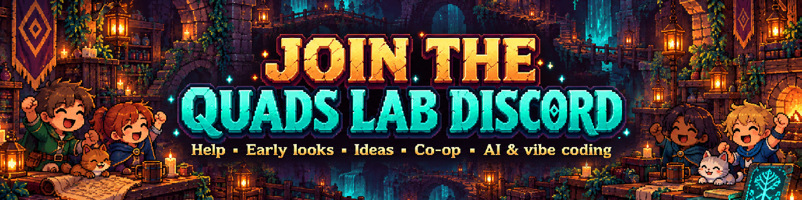
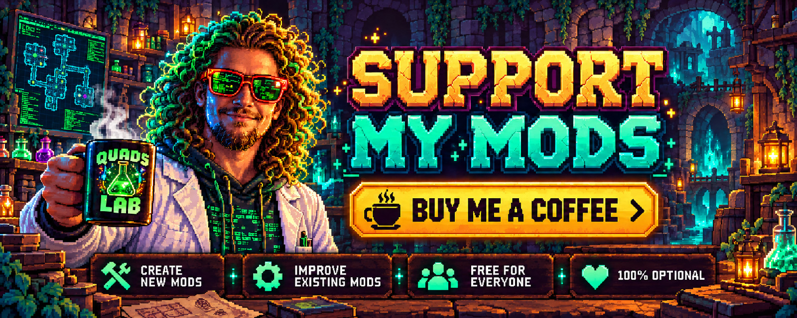

<div align="center">


### Mods for Emberville, by Quads Lab.

[](https://discord.gg/EwTjQxEZPy)  [](https://buymeacoffee.com/quadh)

</div>

My public mods for [Emberville](https://store.steampowered.com/app/5355880/), most of them made for playing together
with **EMP (Ember Multiplayer)**, the online co-op mod.

> **Unofficial fan mods.** Not affiliated with or endorsed by Cygnus Cross. Built for the free **Emberville Demo**;
> Early Access support follows its release.

## The mods

| Mod | What it does | Needs |
|---|---|---|
| [**Party Tricks**](mods/PartyTricks) | Press **G** to cheer: teammates see it, and cheering together makes you both run faster for a moment. Press **B** to light a campfire that slowly heals everyone standing by it, and stays in the host's world. | Ember Multiplayer, and every player in the session |
| [**Damage Colors**](mods/DamageColors) | Recolours the damage numbers on your own screen. | Nothing else: works alone or in multiplayer, and only you need it |

Each mod's page has its keys, settings and changelog.

## Install

The easiest way is a mod manager such as **Gale** ([Hexium](https://emberville.hexium.gg)): install the mod and it
brings what it needs with it, Ember Multiplayer included.

By hand:

1. Install [BepInEx 5](https://github.com/BepInEx/BepInEx) in the game folder (Ember Multiplayer's download
   includes it).
2. Download the mod's zip and unzip it into the game's `BepInEx\plugins\` folder, so you get
   `BepInEx\plugins\<Mod>\<Mod>.dll`.
3. For a multiplayer mod like Party Tricks, everyone you play with installs the same version. If someone doesn't have
   it, the host's game tells them to install it before they can join.

Settings are in `BepInEx\config\` after the first start.

## Building

You need the .NET SDK and the game, with Ember Multiplayer installed in it (the mods compile against its DLL).

```powershell
.\scripts\build.ps1                                  # builds every mod in mods\
.\scripts\build.ps1 -Deploy                          # ...and copies each into the game's BepInEx\plugins\<Name>\
.\scripts\package.ps1 -MultiplayerVersion 0.2.0      # release zips in build\, mod-site packages in build\store\
```

The game folder defaults to `D:\SteamLibrary\steamapps\common\Emberville Demo`; pass `-GameDir` (or set
`EMB_GAMEDIR`) for yours. `-MultiplayerDir` points at a different `EmbervilleMP.dll`.

## Making your own

The multiplayer mods here are built on Ember Multiplayer's public API: your own messages between players, shared
data saved with the host's world, objects every player sees the same, and a check at join that everyone has the mods
they need. Its guide comes with Ember Multiplayer, and Party Tricks and Damage Colors are working examples of
most of it.

## License

Each mod has its own license, in its folder (`mods/<Mod>/LICENSE.md`). Party Tricks and Damage Colors are
**MIT**: use their code in your own mods as you like, keeping the copyright notice.

## 🤖 Made with AI

Made with the help of Claude (Anthropic), with Claude Code: designed, written and checked together, and tried in the game.

## Credits

- **Emberville** by [Cygnus Cross](https://store.steampowered.com/app/5355880/). All game content, names and artwork
  belong to them.
- BepInEx and HarmonyX by their respective authors.
- Made with the help of Claude (Anthropic). Party Tricks' cover and icon were made with AI image generation.

## 💬 Join us on Discord

<a href="https://discord.gg/EwTjQxEZPy"></a>

Come hang out with the people who make and play these mods. In the **Quads Lab Discord** you can:

- 🛠️ **Get help** and report bugs straight to us
- 👀 **See new mods first**, and help test them before they're released
- 🗳️ **Suggest ideas** and vote on what we make next
- 🎮 **Find people to play with**, and share your adventures
- 🤖 **Talk AI coding and vibe coding** with people building things with AI, the way these mods are made

**[Join the Quads Lab Discord →](https://discord.gg/EwTjQxEZPy)**

## 🧪 About Quads Lab

Quads Lab is where **Quad H** ([HardHeadHackerHead](https://github.com/HardHeadHackerHead)) builds software with AI, of every kind:
these Emberville mods are one of its projects. Each mod is designed by a player, written with [Claude Code](https://claude.com/claude-code)
and tested in the game.

- 🌐 [quadslab.io](https://quadslab.io)
- 🧰 [All my Emberville mods](https://github.com/HardHeadHackerHead/emberville-mods), and [Ember Multiplayer](https://github.com/HardHeadHackerHead/ember-multiplayer)
- 💬 [Discord](https://discord.gg/EwTjQxEZPy)
- ☕ [Buy me a coffee](https://buymeacoffee.com/quadh)
- 🐞 Found a bug? [Open an issue on GitHub](https://github.com/HardHeadHackerHead/emberville-mods/issues/new/choose)

## ☕ Support my mods

<a href="https://buymeacoffee.com/quadh"></a>

Every Quads Lab mod is free, and it stays that way. If one of them made your game better and you'd like to say thanks, a coffee
helps me make new mods and keep improving the ones you already play. It's 100% optional, and always appreciated!

**[☕ Buy me a coffee →](https://buymeacoffee.com/quadh)**
