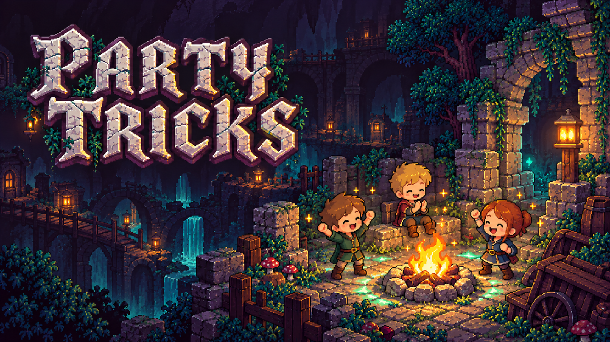

# Party Tricks

    

<!-- GITHUB-ONLY -->[Hexium](https://emberville.hexium.gg/mods/Quads_Lab/Party_Tricks)  ·  <!-- END GITHUB-ONLY -->[Source code](https://github.com/HardHeadHackerHead/emberville-mods/tree/main/mods/PartyTricks)  ·  [Report a bug](https://github.com/HardHeadHackerHead/emberville-mods/issues/new?template=bug.yml&title=%5BParty%20Tricks%5D%20)  ·  [Discord](https://discord.gg/EwTjQxEZPy)

  

Small things to do together in **Emberville** co-op. Needs **Ember Multiplayer**, and **every player in the
session needs Party Tricks** (same version): without it, the host's game tells you to install it before you can join.

## What it does

- **Cheer** (`G`): a burst of sparks and a "Cheer!" over your character. Your teammates see it over you.
  **Cheer together** (two players within 2 seconds, a few steps apart) and you both run **25% faster for 8 seconds**.
- **Campfire** (`B`): light a campfire at your feet. Everyone sees it. Stand next to it to heal slowly. It burns for
  4 minutes, then goes out. Press `B` next to a campfire to put it out (anyone can).
  Campfires stay in the host's world: they're still there next time you all play. A campfire burns only while
  someone is in its area.
- When you join a game, the host's Party Tricks says hello and reminds you of the keys.

## Keys and settings

`BepInEx\config\quadslab.emberville.partytricks.cfg` (made on first start):

| Setting | Default | What |
|---|---|---|
| `Keys / Cheer` | `G` | Cheer. (`C` is the game's character panel.) |
| `Keys / Campfire` | `B` | Light a campfire, or put out the one next to you. (`V` is Ember Multiplayer's push-to-talk.) |
| `Cheer / BoostSeconds` | `8` | How long cheering together makes you faster. |
| `Cheer / BoostPercent` | `25` | How much faster. |
| `Campfire / BurnMinutes` | `4` | How long a campfire burns. |
| `Campfire / HealRadius` | `2.5` | How close you must stand to heal. |

The host decides the boost (its settings count for everyone); each player's own campfires burn as long as their own
setting says.

## Install

1. Install **Ember Multiplayer** (and BepInEx 5) first.
2. Unzip `PartyTricks-<version>.zip` into the game's `BepInEx\plugins\` folder (you get `BepInEx\plugins\PartyTricks\PartyTricks.dll`).
   With a mod manager (Gale, r2modman), install "Party Tricks": it brings Ember Multiplayer with it.
3. Everyone in your group installs it too.

## For mod makers

Party Tricks is an example of a mod built on Ember Multiplayer's public API: a channel (cheers), a host
decision told to two players (the boost), the world's and the session's shared data (cheer and combo counts), a
spawned object with its own state, saved with the world (campfires), an intent to the scene's runner (putting one
out), a join greeting, and self-tests the multiplayer mod's harness runs. See the API guide that comes with Ember Multiplayer (`docs/API.md`).

## 🤖 Made with AI

Made with the help of Claude (Anthropic), with Claude Code: designed, written and checked together, and tried in the game.

## 💬 Join us on Discord

Come hang out with the people who make and play these mods. In the **Quads Lab Discord** you can:

- 🛠️ **Get help** and report bugs straight to us
- 👀 **See new mods first**, and help test them before they're released
- 🗳️ **Suggest ideas** and vote on what we make next
- 🎮 **Find people to play with**, and share your adventures
- 🤖 **Talk AI coding and vibe coding** with people building things with AI, the way these mods are made

**[Join the Quads Lab Discord →](https://discord.gg/EwTjQxEZPy)**

## 🧪 About Quads Lab

Quads Lab is where **Quad H** ([HardHeadHackerHead](https://github.com/HardHeadHackerHead)) builds software with AI, of every kind:
these Emberville mods are one of its projects. Each mod is designed by a player, written with [Claude Code](https://claude.com/claude-code)
and tested in the game.

- 🌐 [quadslab.io](https://quadslab.io)
- 🧰 [All my Emberville mods](https://github.com/HardHeadHackerHead/emberville-mods), and [Ember Multiplayer](https://github.com/HardHeadHackerHead/ember-multiplayer)
- 💬 [Discord](https://discord.gg/EwTjQxEZPy)
- ☕ [Buy me a coffee](https://buymeacoffee.com/quadh)
- 🐞 Found a bug? [Open an issue on GitHub](https://github.com/HardHeadHackerHead/emberville-mods/issues/new/choose)

## ☕ Support my mods

Every Quads Lab mod is free, and it stays that way. If one of them made your game better and you'd like to say thanks, a coffee
helps me make new mods and keep improving the ones you already play. It's 100% optional, and always appreciated!

**[☕ Buy me a coffee →](https://buymeacoffee.com/quadh)**

## 📜 Recent changes

<!-- RECENT-CHANGES (scripts/store.py --update-readme writes this from the changelog) -->
- **1.0.0** First release: cheers (cheer together for a speed boost) and campfires (heal the party, saved in the host's world). Needs Ember Multiplayer with its mod API (API version 1).
<!-- END RECENT-CHANGES -->

<!-- GITHUB-ONLY -->[Every change](CHANGELOG.md)<!-- END GITHUB-ONLY --><!-- STORE-ONLY: Every change is on the Changelog tab. -->

Unofficial fan mod, not affiliated with Cygnus Cross. License: MIT (see [LICENSE.md](LICENSE.md)).
